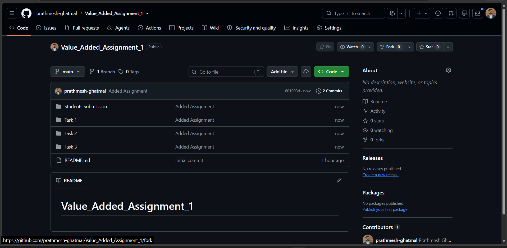
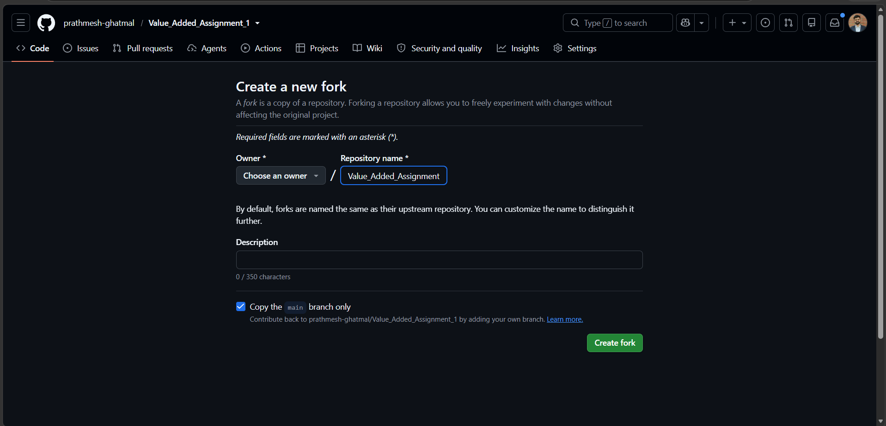
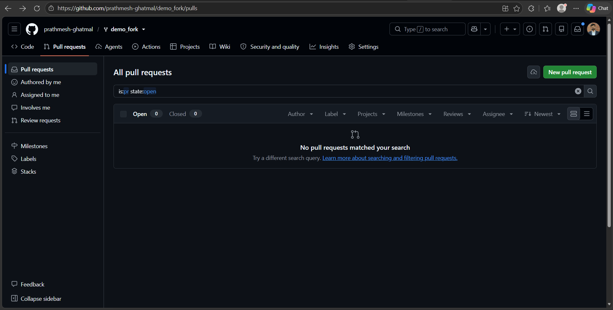
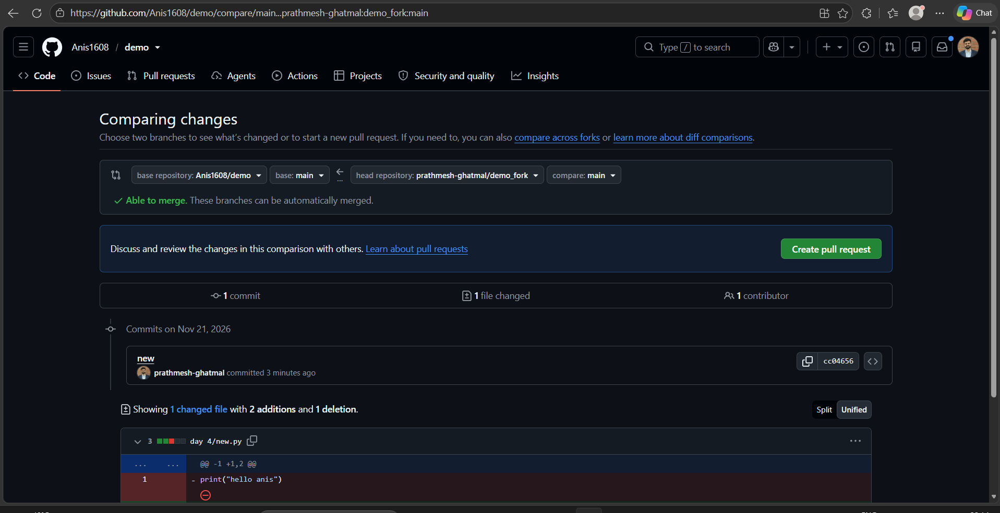

# Value Added Assignment 1 — Submission Instructions

Read **all instructions carefully** before starting. Submissions that do not follow the required repository structure or GitHub submission process may not be considered correctly submitted.

## 1. Open the Assignment Repository

Visit the original assignment repository:

**[Value Added Assignment 1](https://github.com/prathmesh-ghatmal/Value_Added_Assignment_1.git)**

This is the original repository. **Do not make your changes directly in this repository.** You must first create your own fork.



## 2. Fork the Repository

1. Open the repository link above.
2. Click the **Fork** button near the top-right corner of the repository page.

   
3. On the **Create a new fork** page, keep the repository name exactly as it is. **Do not rename the repository.**
4. Select your own GitHub account as the owner, if prompted.
5. Keep **Copy the `main` branch only** selected.
6. Click **Create fork**.

   

You should now have your own copy of the assignment repository under your GitHub username. Verify that the page shows that it is forked from the original repository.


## 3. Clone Your Fork to Your Computer

Open your newly created fork on GitHub—not the original repository.


1. Click the green **Code** button.
2. Copy the HTTPS clone URL.
3. Open a terminal (VS Code Terminal, PowerShell, or Git Bash).
4. Run the following command, replacing `YOUR-GITHUB-USERNAME` with your actual GitHub username:

```bash
git clone https://github.com/YOUR-GITHUB-USERNAME/Value_Added_Assignment_1.git
```

5. Move into the cloned project directory:

```bash
cd Value_Added_Assignment_1
```

**Important:** Clone your fork (the repository under your username). Do not clone the instructor's original repository for your submission work.

## 4. Create Your Required Submission Folder Structure

Inside the repository, open the `Students Submission` folder. Create **one folder named using your full roll number, first name, and last name**.

Use this naming format:

```text
FULLROLLNO_FirstName_LastName
```

Example (use your own details, not the example):

```text
2401055_Prathmesh_Ghatmal
```

Inside your personal folder, create a separate folder for each task. Save each task's HTML and CSS files inside its corresponding task folder.

Required structure:

```text
Value_Added_Assignment_1/
└── Students Submission/
    └── FULLROLLNO_FirstName_LastName/
        ├── Task 1/
        │   ├── index.html
        │   └── style.css
        ├── Task 2/
        │   ├── index.html
        │   └── style.css
        └── Task 3/
            ├── index.html
            └── style.css
```

The repository already contains the assignment folders and reference images. **Do not delete, rename, or modify the assignment's original files.** Add your own submission folder only.


## 5. Complete All Three Tasks

- Complete **Task 1, Task 2, and Task 3** using **HTML and CSS only**.
- Recreate the provided UI/reference as accurately as you can.
- Use appropriate HTML structure and CSS styling.
- Keep your HTML and CSS organized and readable.
- Your work must be written and understood by you.


## 6. Strict Rules — Read Carefully

### AI-generated code is strictly prohibited

**Do not use AI tools to generate, write, modify, debug, or complete your HTML or CSS code for this assignment.** The implementation must be your own work.

### Explain your logic using code comments

Add comments in your code explaining the logic behind your structure and styling choices. Comments should demonstrate that you understand what you have written; do not add meaningless or copied comments.

### Additional rules

- Use **HTML and CSS only**. Do not use JavaScript.
- Do not copy another student's solution.
- Do not submit someone else's code as your own.
- Do not modify the original task/reference files.
- Do not place your solutions outside your own roll-number/name folder.
- Follow the exact folder and file naming structure specified above.
- You are responsible for understanding every line of code you submit. Your work may be checked and you may be asked to explain or modify it.

Violation of these rules may affect your assignment evaluation.


## 7. Commit and Push Your Work to Your Fork

After completing your work, open the terminal inside the repository folder and run:


1. Check the files you changed:

```bash
git status
```

2. Stage your work:

```bash
git add .
```

3. Commit your work with a meaningful commit message:

```bash
git commit -m "Completed Value Added Assignment 1"
```

4. Push your commit to your GitHub fork:

```bash
git push origin main
```

This pushes your changes to **your own fork**. It does not submit your assignment to the original repository yet.


## 8. Submit Your Assignment Through a Pull Request

After you have successfully pushed your changes to GitHub:


1. Open **your fork** on GitHub.
2. Click the **Pull requests** tab.
3. Click **New pull request**.
4. Check the repository and branch selections carefully. They must be:

   - **Base repository:** `prathmesh-ghatmal/Value_Added_Assignment_1`
   - **Base branch:** `main`
   - **Head repository:** your fork (`YOUR-GITHUB-USERNAME/Value_Added_Assignment_1`)
   - **Compare branch:** `main`

5. Confirm that your changes are listed in the comparison.
6. Click **Create pull request**.
7. Give your PR a clear title in this format:

   ```text
   Value Added Assignment 1 Submission – FULLROLLNO FirstName LastName
   ```

8. In the description, briefly mention that you have completed Tasks 1, 2, and 3.
9. Submit the Pull Request.





**Do not merge your Pull Request.** The instructor will review and merge submissions if/when appropriate.


## 9. Final Submission Checklist

Before you consider your assignment submitted, verify every item below:

- [ ] I forked the original repository to my own GitHub account.
- [ ] I cloned **my fork**, not the original repository.
- [ ] I created my personal folder using my full roll number, first name, and last name.
- [ ] My Task 1, Task 2, and Task 3 solutions are inside their respective folders.
- [ ] Each task contains the required HTML and CSS files.
- [ ] I used HTML and CSS only; I did not use JavaScript.
- [ ] I did not use AI to generate or modify my solution code.
- [ ] I added meaningful comments explaining my code logic.
- [ ] I committed my work and pushed it to my fork.
- [ ] I created a Pull Request to the original repository's `main` branch.
- [ ] My Pull Request is open and has not been merged by me.


## Submission is Complete Only When

**Your work is pushed to your fork AND a Pull Request has been created against the original repository.** Simply completing the code locally or pushing it to your fork is not a complete submission.


If you are unsure about the GitHub process, ask for help **before** submitting incorrectly. Do not skip steps or change the repository/folder naming rules.
